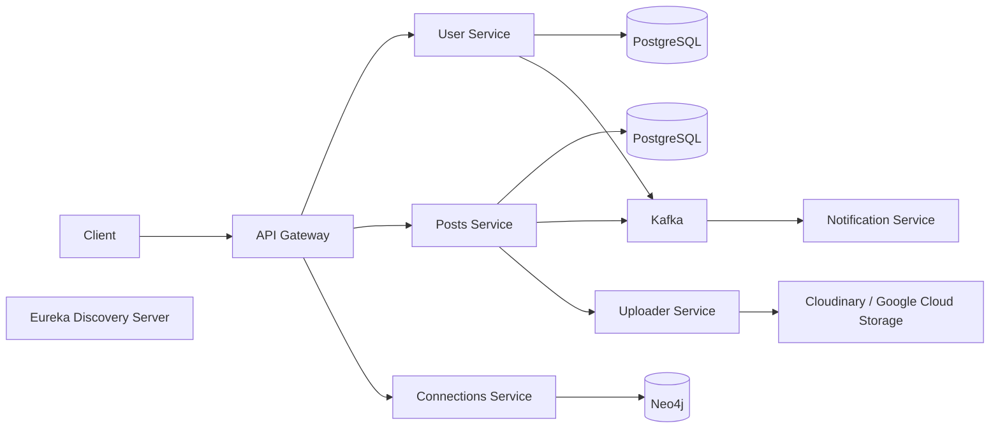

# Social Network Platform

A Java 21 microservices backend for user accounts, posts, connections, notifications, and media uploads. The services use Spring Boot and communicate through HTTP, Kafka, and service discovery.

## Architecture



## Services

| Module | Responsibility | Default port |
| --- | --- | ---: |
| `api-gateway` | API routing and JWT authentication | 8080 |
| `discovery-server` | Eureka service registry | 8761 |
| `posts-service` | Post creation, retrieval, and likes | 9010 |
| `user-service` | User registration, authentication, and profiles | 9020 |
| `connections-service` | Connection requests and relationships | 9030 |
| `notification-service` | Notifications from application events | 9040 |
| `uploader-service` | Media upload integrations | 9050 |

## Technology

- Java 21 and Spring Boot
- Spring Cloud Gateway, Eureka, OpenFeign, and JPA
- PostgreSQL, Neo4j, and Kafka
- Cloudinary and Google Cloud Storage
- Kubernetes manifests in [`k8s/`](k8s/)

## Build and test

Each service is an independent Maven project. Build and run its tests from the module directory:

```sh
cd user-service
./mvnw clean verify
```

Repeat for the other modules. Windows users can run `mvnw.cmd`. Container image builds are explicit and are not part of the standard Maven lifecycle. To build and push an image, configure Docker registry access and `DOCKERHUB_USERNAME`, then run:

```sh
./mvnw jib:build
```

## Local configuration

Run the required databases, Kafka, and service dependencies before starting the application modules. Local service configuration expects dependencies on `localhost`.

Provide credentials through environment variables or a secrets manager; do not commit them:

| Variable | Used by |
| --- | --- |
| `DB_USERNAME`, `DB_PASSWORD` | Local database credentials; Neo4j credentials for `connections-service` |
| `JWT_SECRET` | `api-gateway` and `user-service`; use the same strong value for both |
| `CLOUDINARY_CLOUD_NAME`, `CLOUDINARY_API_KEY`, `CLOUDINARY_API_SECRET` | `uploader-service` |
| `GCLOUD_STORAGE_ACCESS_KEY` | Google Cloud service-account JSON contents for `uploader-service` |
| `GCLOUD_STORAGE_BUCKET_NAME` | Google Cloud Storage bucket for `uploader-service` |

The local PostgreSQL database names are `userDB`, `postsDB`, and `notificationDB`.

## Kubernetes

The manifests in [`k8s/`](k8s/) expect a Kubernetes Secret named `app-secrets` containing:

- `USER_DB_USERNAME`, `USER_DB_PASSWORD`
- `POSTS_DB_USERNAME`, `POSTS_DB_PASSWORD`
- `NOTIFICATION_DB_USERNAME`, `NOTIFICATION_DB_PASSWORD`
- `CONNECTIONS_DB_USERNAME`, `CONNECTIONS_DB_PASSWORD`, `CONNECTIONS_NEO4J_AUTH`
- `JWT_SECRET`
- `CLOUDINARY_CLOUD_NAME`, `CLOUDINARY_API_KEY`, `CLOUDINARY_API_SECRET`
- `GCLOUD_STORAGE_ACCESS_KEY`, `GCLOUD_STORAGE_BUCKET_NAME`
